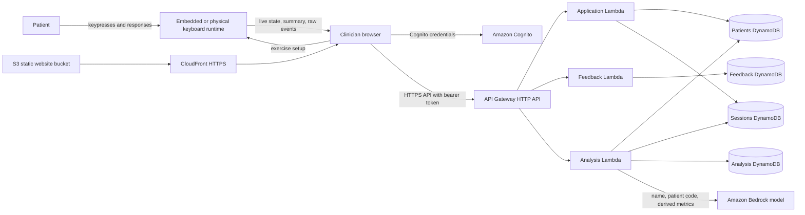

# Stella System, Data Flow, and HIPAA Scope

Last reviewed: October 14, 2026

## Purpose and limits

This document describes the current Stella prototype, the proposed physical
keyboard, the deployed web application and AWS backend, and the data created by
an exercise. It is intended to support a HIPAA scoping discussion, security risk
analysis, and vendor/legal review.

This is not a legal opinion or a statement that Stella is HIPAA compliant. HIPAA
applicability depends on who operates Stella, for whom it operates, why the data
is processed, and whether the information identifies or can reasonably identify
an individual.

## Executive conclusion

For Stella's intended clinic-facing patient reporting use, the safe working
assumption is that HIPAA matters.

Stella stores patient names, patient codes, free-text notes, exercise results,
fine-grained keypress timing, and clinician-generated analysis together. If a
HIPAA covered provider uses Stella to provide care, and Stella or its operator
creates, receives, maintains, or transmits that information on the provider's
behalf, Stella's operator would commonly be acting as a business associate and
the linked data would be electronic protected health information (ePHI). HHS
specifically lists a health-app developer working on behalf of a covered entity
as an example of a business associate.

HIPAA may not apply to a prototype that uses only fictitious data, or to an
organization that is neither a covered entity nor a business associate. That
does not mean there are no privacy obligations: the FTC Health Breach
Notification Rule and state health/privacy laws may apply to health apps and
connected devices that fall outside HIPAA.

Do not use real patient data in the current prototype until the applicability
decision, risk analysis, contracts, and remediation plan have been completed.

## System boundary at a glance

Trust boundaries that require separate review are:

1. Patient to keyboard hardware.
2. Physical keyboard to clinician browser over the clinic network.
3. Browser to Cognito and the Stella API over the internet.
4. Lambda functions to DynamoDB and Bedrock inside AWS.
5. Administrators, developers, support personnel, logs, backups, and exported
   data outside the normal application path.

## Physical keyboard

### Intended hardware

The historical hardware plan describes a tactile keyboard with three rows of
ten large buttons. Twenty-six positions represent letters and four positions are
reserved. Each position has a switch and a round display that can show a letter
and change color for cues and feedback.

The planned controller is a Wi-Fi-capable Raspberry Pi Pico W. It is intended to
read keypresses, measure their timing locally, control the displays, play spoken
audio, and communicate with the clinician's browser. The historical design also
mentions a microSD card for audio and a local session-data copy.

These details come from the historical
[`Stella_Hardware_Overview.md`](./old/Stella_Hardware_Overview.md). They are a
design description, not verification of production hardware. This repository
does not contain or validate Raspberry Pi firmware, device storage encryption,
secure boot, patching, physical tamper controls, or hardware lifecycle controls.

### Current software representation

The repository currently provides two runtime modes:

- `embedded`: the exercise runs entirely in the browser. This is the checked-in
  and deployed default.
- `device`: Stella sends configuration to a keyboard HTTP API, watches live
  events, fetches results, and saves them through the same backend session API.

`device-simulator/` implements the proposed device contract for development. It
represents the keyboard, Raspberry Pi exercise engine, API, audio, and local
patient-facing keyboard screen. It is not production firmware.

The keyboard address space contains 30 key IDs. QWERTY letter positions use IDs
1-19 and 22-28; IDs 20, 21, 29, and 30 are reserved. Supported layouts are
QWERTY and alphabetical, with full, left, or right keyboard sides and visible or
blank labels. Letter Find always uses visible letters.

### Device interface

The device contract uses JSON over HTTP and Server-Sent Events (SSE). It exposes
configuration, start, stop, state, live presentation events, results, and raw
JSONL/CSV export endpoints. See [`api-reference.md`](./api-reference.md).

The development device API currently has no authentication or pairing, uses
plain HTTP by default, permits broad local-development CORS, and keeps only the
latest completed session in memory. Authentication, TLS, discovery, offline
retry, hardware verification, and production storage behavior remain design
work. A browser page delivered over HTTPS also cannot safely call a plain HTTP
device endpoint.

If a production keyboard stores session data on removable media, the media and
the device become part of the ePHI system boundary and require inventory,
encryption, access control, secure disposal, loss/theft response, and retention
decisions.

## Stella web application

The active UI is a React and TypeScript single-page application in `stella/`.
It lets a clinician:

- authenticate;
- create and view patient records;
- configure and launch exercises;
- run the embedded keyboard or control a device runtime;
- view session summaries, charts, and raw-derived metrics;
- create feedback notes; and
- generate patient analysis and recommendations.

The deployed static files are held in a private S3 bucket and delivered through
CloudFront. CloudFront redirects viewers to HTTPS. The current runtime
configuration enables Cognito authentication and points the browser at the
HTTPS API endpoint.

The browser currently stores Cognito tokens in `localStorage`. When the API is
not configured, local mock mode can also store patients, sessions, feedback, and
analysis in `localStorage`. Production should fail closed rather than falling
back to local mock persistence, and sensitive tokens or ePHI should not be left
in browser storage without a documented risk decision and compensating controls.

## AWS backend

The backend is defined with AWS CDK in
[`infra/lib/stellaportal-stack.ts`](../infra/lib/stellaportal-stack.ts).

| Component | Current purpose | Potential sensitive data |
|---|---|---|
| Amazon Cognito | Clinician accounts and JWT authentication | Email, subject ID, groups, authentication metadata |
| Clinics DynamoDB table | Clinic tenant records | Clinic name, status, and creation metadata |
| Memberships DynamoDB table | Maps Cognito users to clinics and roles | Cognito subject ID, email, clinic ID, role, and status |
| API Gateway HTTP API | Authenticated application routes | Patient IDs, request/response data, network/request metadata |
| Application Lambda | Patient and exercise-session CRUD and metric mapping | Names, codes, notes, session metrics, raw events |
| Feedback Lambda | Page and patient-linked feedback notes | Clinician identity, patient ID, free-text comments |
| Analysis Lambda | Builds trends and invokes a Bedrock model | Patient name/code and derived performance data |
| Patients DynamoDB table | Patient records | First/last name, patient code, notes, creation date |
| Sessions DynamoDB table | Exercise sessions | Configuration, metrics, timestamps, raw runtime/device payload |
| Feedback DynamoDB table | Feedback notes | Author identity, patient ID, route context, comment |
| Analysis DynamoDB table | Generated analysis | Patient ID, trends, recommendations, model output |
| Amazon Bedrock | Generates clinician-facing narrative | Full patient name, patient code, session count, derived metrics and recommendations |
| S3 and CloudFront | Hosts the frontend | Normally static assets only; should never receive patient data |
| CloudWatch | Default Lambda/service logs and operational telemetry | Errors and request metadata; could contain PHI if code later logs payloads |

The API Gateway routes use a Cognito authorizer, so a valid user-pool token is
required. The UI also checks membership in `stella-poc-users`. The backend now
requires an active clinic membership and scopes patient, session, analysis, and
feedback access to the selected clinic. Write operations require the
`clinic-admin` or `clinician` role. Clinic creation and membership administration
require the `stella-platform-admins` Cognito group. These controls provide a
tenant-isolation foundation, but still require production deployment testing,
audit logging, access-review procedures, and review of patient-level access
requirements.

The CDK grants each Lambda access to its required tables, which is a useful
least-privilege foundation. However, the current stack does not explicitly
configure customer-managed encryption keys, point-in-time recovery, production
deletion protection, API access logging, application audit logging, MFA, WAF,
or security alarms. DynamoDB tables and the Cognito user pool use a `DESTROY`
removal policy, which is appropriate for a disposable prototype but not for a
production health-data system without an explicit, tested retention decision.

The HTTP API CORS configuration currently allows all origins. Production should
allow only the intended Stella origins.

## Data produced by the keyboard

The keyboard produces behavioral performance data rather than a diagnosis. Once
that data is linked to a patient and used in care, reporting, or treatment
planning, it can become identifiable health information regardless of whether
the keyboard itself knows the patient's name.

### Common configuration data

- exercise/activity type;
- participant code;
- keyboard layout, side, and label visibility;
- letter or word content mode and item counts;
- word-length range;
- silent, metronome, or music mode and tempo;
- Eye Pong mode;
- response window and Go/Stop distribution;
- motor-sequence length and progression settings; and
- device serial number, firmware version, capabilities, and functioning keys
  when supplied by a physical device.

### Common event data

- device sequence number and device timestamp;
- device session ID;
- event type and exercise phase;
- prompt, target key ID, and target letter;
- pressed key ID and pressed letter;
- whether the response was correct;
- response latency and relative offset;
- beat timestamp and timing offset;
- item/trial number and completion outcome;
- session start, stop, completion, and end reason; and
- live board colors, prompt text, progress, and referenced audio clip.

### Exercise-specific results

| Exercise | Representative generated data |
|---|---|
| Letter Target | Target and pressed letters, attempts, incorrect keys, correct latency, accuracy, first-attempt success, miss direction/distance, per-key/per-word results, rhythm timing |
| Letter Find | Requested letter/word, search attempts, correct latency, accuracy, first-attempt success, per-key/per-word and sequence performance |
| Eye Pong | Target key sequence, presentation timing, left-right or random mode, tempo, target changes, completion rate |
| Inhibition Challenge | Go or Stop (`no-go`) cue, target, response/no response, correct inhibition, false response, missed Go, Go latency, per-cue accuracy |

The device returns a calculated summary plus an authoritative raw JSONL event
log. Stella maps those into report fields and preserves the complete device
summary and events under `rawEventPayload.devicePayload`. Representative
payloads for all five exercises are in
[`exercise-data-examples.json`](./exercise-data-examples.json), and the field
definitions are in [`exercise-data-model.md`](./exercise-data-model.md).

## End-to-end data flows

### Embedded runtime

1. The clinician selects a patient and exercise configuration in Stella.
2. The browser runs the exercise and records prompts, keypresses, correctness,
   timestamps, and timing measurements.
3. The browser calculates a run result and sends the patient ID, setup, status,
   duration, completed units, and raw result to `POST /sessions`.
4. API Gateway validates the Cognito token and invokes the application Lambda.
5. The Lambda calculates report metrics and stores the session, including
   `rawEventPayload`, in the Sessions DynamoDB table.
6. Later reads return those sessions to authenticated browsers for reporting.

### Physical-device runtime

1. The clinician selects a patient and configuration in Stella.
2. The browser sends configuration, including a participant identifier, to the
   device API.
3. The patient presses physical keys; the device generates live SSE state and
   records raw events locally.
4. At completion, Stella fetches the device summary and raw JSONL export.
5. Stella nests that complete payload in `rawEventPayload.devicePayload` and
   sends it to the backend session API.
6. The backend stores the translated metrics and full device payload in
   DynamoDB.

This mode creates at least two copies of the event data: one on or in the device
runtime and one in AWS. Browser memory, network intermediaries, exports, logs,
backups, and support tooling can create additional copies.

### Analysis flow

1. The analysis Lambda reads the named patient record and all of that patient's
   exercise sessions.
2. It calculates recent/baseline aggregates and configuration recommendations.
3. It sends the patient's full name, patient code, session count, derived
   evidence, performance aggregates, and recommendation context to Amazon
   Bedrock.
4. It stores the returned narrative and analysis in DynamoDB.

This means Bedrock use must be included in the data inventory, AWS BAA/service
eligibility review, regional/configuration review, minimum-necessary analysis,
and privacy notice/contract review. A lower-risk design would omit the patient's
name and patient code from the model prompt unless they are demonstrably needed.

### Feedback flow

Feedback notes store clinician identity, page/route context, optional patient ID,
exercise type, and free-text comments. Free text must be treated as potentially
containing PHI even when users are instructed not to enter it.

## Data location inventory

| Location | Current data/copy | Persistence |
|---|---|---|
| Physical keyboard or simulator memory | Configuration, current state, latest summary and raw events | Simulator: memory until restart; physical behavior not yet defined |
| Proposed device microSD | Audio and possibly a session-data copy | Historical design only; retention/encryption undefined |
| Browser memory | Patient records, configurations, live events, API responses | Until navigation/reload/process exit; browser behavior varies |
| Browser `localStorage` | Cognito session; mock patients, sessions, feedback, and analysis when local mode is used | Persists until cleared |
| DynamoDB Patients | Identifiers and patient notes | Until deleted, table removed, or environment destroyed |
| DynamoDB Sessions | Metrics and full raw runtime/device payload | Same |
| DynamoDB Feedback | Clinician identity, context, and comments | Same |
| DynamoDB Analysis | Generated summaries and recommendations | Same |
| Bedrock inference request/response path | Identifiers and derived patient performance data | Must be confirmed under the selected AWS service terms and configuration |
| CloudWatch/service telemetry | Errors and operational/request metadata | AWS/service retention settings; explicit app log retention is not configured in this stack |
| Developer exports and screenshots | Potential patient/session data | Outside application control unless governed operationally |

## Does HIPAA apply?

Use this decision path with qualified privacy counsel or the organization's
privacy officer:

1. **Is the operator a covered entity?** A health plan, clearinghouse, or health
   care provider that conducts covered electronic transactions may be a HIPAA
   covered entity.
2. **Is Stella provided for or on behalf of one?** If Stella handles patient
   information to provide patient management, analysis, reporting, or another
   service for a covered entity, the Stella operator is likely a business
   associate. Subcontractors that handle the data can also be business
   associates.
3. **Is the data identifiable health information?** In the current model, names,
   patient codes, timestamps, notes, device/session identifiers, and performance
   information are stored together. That should be treated as identifiable.
4. **Is the data genuinely de-identified?** Replacing a name with a patient code
   is pseudonymization, not automatically HIPAA de-identification. HIPAA provides
   two routes: Safe Harbor removal of specified identifiers plus no actual
   knowledge of re-identification, or documented Expert Determination.
5. **If HIPAA does not apply, what does?** Evaluate the FTC Health Breach
   Notification Rule, applicable state consumer-health and medical-privacy laws,
   children's privacy rules where relevant, contracts, research rules, and
   ordinary security and breach obligations.

### Practical scenarios

| Scenario | Working conclusion |
|---|---|
| Demo using only invented patients and exercise events | Generally no real PHI is involved; keep it isolated from real identifiers |
| Clinic uses Stella in treatment and patient reporting | Treat as HIPAA/ePHI in scope; determine business-associate roles and execute BAAs |
| Stella sells directly to consumers with no covered-entity relationship | HIPAA may not apply, but FTC/state health-data rules may apply |
| Research deployment | HIPAA status depends on the entities and data source; IRB/Common Rule, authorization/waiver, and data-use obligations may also apply |
| Data set formally de-identified under Safe Harbor or Expert Determination | HIPAA Privacy Rule no longer treats the resulting data as PHI, but security, contract, re-identification, and other-law obligations remain |

## Current safeguards and material gaps

### Safeguards already present

- HTTPS delivery through CloudFront and an HTTPS API endpoint.
- Private S3 origin with blocked public access and CloudFront origin access.
- Cognito user authentication and JWT authorization on API routes.
- Server-side clinic membership, role, and tenant isolation checks.
- Separate clinic and membership tables with point-in-time recovery enabled.
- No self-service Cognito sign-up.
- Twelve-character password minimum with upper/lowercase and digits.
- Separate Lambda functions for application, feedback, and analysis workloads.
- Table-specific read/write grants for the Lambda roles.
- Structured TypeScript data models and a documented device API boundary.
- Full raw event retention makes current calculations traceable, although it
  increases sensitivity and retention risk.

### Gaps to resolve before real PHI

1. Complete a documented security risk analysis and assign privacy/security
   owners.
2. Determine covered-entity/business-associate roles and sign BAAs with AWS,
   customers, and any subcontractor that handles ePHI.
3. Confirm every AWS service and feature used with ePHI is permitted under the
   executed AWS BAA, including the selected Bedrock model and Region.
4. Remove names and patient codes from Bedrock prompts unless required; document
   the minimum-necessary rationale for every field sent.
5. Test clinic isolation in the deployed environment and decide whether clinic
   roles are sufficient or individual clinician-to-patient assignments are also
   required.
6. Require MFA and implement account provisioning, termination, access review,
   session timeout, and emergency-access procedures.
7. Replace persistent browser token storage with a risk-reviewed session design
   and prohibit production fallback to mock `localStorage` data.
8. Add application audit events for every patient record view, creation,
   modification, export, analysis, and deletion. Protect logs from alteration
   and monitor them.
9. Configure device identity, secure pairing, TLS, authorization, signed updates,
   encrypted local storage, clock integrity, patching, inventory, and remote
   decommissioning.
10. Restrict CORS, validate request bodies at the Lambda boundary, set payload
    limits, rate limits, security headers, and abuse monitoring.
11. Configure explicit encryption/key-management decisions, backup and
    point-in-time recovery, deletion protection, tested restoration, and
    production-safe removal policies.
12. Define retention and deletion periods separately for raw events, derived
    sessions, audit logs, analysis, feedback, device copies, exports, and
    backups. Collect only data needed for the stated purpose.
13. Prevent PHI in logs and error responses; set log retention and add security,
    availability, and anomalous-access alarms.
14. Establish incident response, breach assessment/notification, disaster
    recovery, vendor management, workforce training, workstation/device, and
    facility policies. Test them and retain evidence.
15. Add dependency, secret, infrastructure, integration, and authorization
    testing plus an independent penetration/security assessment before a pilot.

## Questions for the HIPAA scoping review

Record written answers and the person who approved each answer:

- Who owns and operates Stella in each deployment?
- Is the customer a HIPAA covered entity, and is Stella acting on its behalf?
- Is Stella part of treatment, payment, health care operations, research, or a
  direct-to-consumer service?
- Which fields are necessary, and can the device use a random run ID rather than
  a patient code?
- Does the physical keyboard retain data after upload? If so, where, for how
  long, and under what encryption and deletion controls?
- Which people and roles may see which patients and which raw events?
- Are exact timestamps, key-level events, device identifiers, and full raw logs
  clinically necessary after summary metrics are calculated?
- Will clinicians enter PHI into patient notes or feedback comments?
- Which AWS account, Region, services, models, logs, backups, and support paths
  receive ePHI?
- Is an AWS BAA executed for the production account, and has service eligibility
  been confirmed rather than assumed?
- What customer data export, amendment, accounting, return, and deletion duties
  must Stella support?
- Which non-HIPAA laws apply based on patient age, location, consumer offering,
  research use, and device classification?

## Evidence to retain

A defensible program should retain more than a checklist. Keep:

- the signed applicability/role determination and BAAs;
- current system/data-flow diagrams and asset inventory;
- risk analysis, remediation register, and risk acceptances;
- data classification, minimum-necessary, retention, and deletion decisions;
- access approvals/reviews and workforce training records;
- infrastructure configuration, deployment approvals, test results, and change
  history;
- vulnerability scans, penetration-test reports, patches, and incident drills;
- backup restoration and disaster-recovery test evidence; and
- audit-log review evidence and documented incident/breach decisions.

## Authoritative references

- [HHS: Covered Entities and Business Associates](https://www.hhs.gov/hipaa/for-professionals/covered-entities/index.html)
- [HHS: Business Associates](https://www.hhs.gov/hipaa/for-professionals/privacy/guidance/business-associates/index.html)
- [HHS: Summary of the HIPAA Security Rule](https://www.hhs.gov/hipaa/for-professionals/security/laws-regulations/index.html)
- [HHS: HIPAA Security Rule](https://www.hhs.gov/hipaa/for-professionals/security/index.html)
- [HHS: De-identification Guidance](https://www.hhs.gov/hipaa/for-professionals/special-topics/de-identification/index.html)
- [HHS: Cloud Computing Guidance](https://www.hhs.gov/hipaa/for-professionals/special-topics/health-information-technology/cloud-computing/index.html)
- [FTC: Complying with the Health Breach Notification Rule](https://www.ftc.gov/business-guidance/resources/complying-ftcs-health-breach-notification-rule-0)
- [FTC: Mobile Health Apps Interactive Tool](https://www.ftc.gov/business-guidance/resources/mobile-health-apps-interactive-tool)

The HHS site identifies the January 2025 Security Rule changes as a proposed
rule and separately identifies the currently effective Security Rule. This
document uses the current rule for its legal baseline while recommending modern
security practices that would also prepare Stella for stricter requirements.
